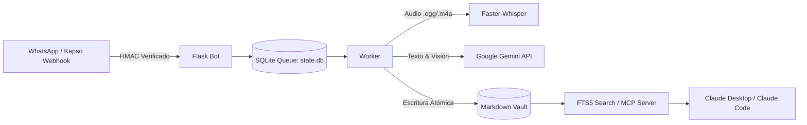

# 🧠 Second Brain & WhatsApp AI Assistant

Sistema de **Segundo Cerebro (Second Brain)** y memoria persistente basado en un Vault de Markdown, potenciado por **Google Gemini**, transcripción local con **Faster-Whisper** y un bot conversacional 24/7 integrado con **WhatsApp Cloud API (Kapso)** y **Model Context Protocol (MCP)**.

---

## 🚀 Características Principales

- **📂 Vault Estructurado en Markdown:** Arquitectura de memoria en 3 capas inspirada en el método PARA/Second Brain (Capa 1: Contexto Operativo, Capa 2: Áreas y Resúmenes, Capa 3: Archivo Profundo).
- **🤖 Asistente de WhatsApp 24/7:** Bot en Flask conectado a Kapso (WhatsApp Cloud API) para captura de ideas, notas de voz, minutas y gestión de pendientes en tiempo real.
- **🎙️ Procesamiento de Audio & Multimodal:** Transcripción de notas de voz con `faster-whisper` (int8 en CPU) y análisis multimodal de imágenes y documentos mediante la API de Google Gemini.
- **🔍 Búsqueda Híbrida & MCP:** Servidor MCP local con motor de búsqueda FTS5 (BM25) para conectar sin problemas con **Claude Desktop** y **Claude Code**.
- **🔒 Privacidad y Control de Escritura:** Escritura atómica concurrente (`vault_io.py`) con control de versiones Git automatizado y aislamiento de variables sensibles.

---

## 🏗️ Arquitectura del Sistema



---

## 📁 Estructura del Repositorio

```text
second-brain/
├── meta/               # Capa 1: Contexto operativo, prioridades y pendientes
├── areas/              # Capa 2: Resúmenes por área personal y profesional
├── journal/            # Capa 3: Bitácora diaria y resúmenes semanales/mensuales
├── people/             # Directorio de personas clave y relaciones
├── projects/           # Proyectos activos y empresas
├── sources/            # Documentos fuente, presentaciones y multimedia
├── inbox/              # Bandeja de entrada para material sin procesar
├── automation/         # Scripts del pipeline, bots y servidores MCP
│   ├── kapso_whatsapp_bot.py      # Servidor Webhook de WhatsApp
│   ├── audio_processor.py         # Transcripción Whisper y análisis Gemini
│   ├── vault_io.py                # Gestor de lectura/escritura atómica
│   ├── mcp_buscar.py              # Servidor MCP de búsqueda
│   ├── indice.py                  # Constructor y buscador FTS5
│   └── tests/                     # Suite de pruebas automatizadas
├── .env.example        # Plantilla de variables de entorno
└── CLAUDE.md           # Reglas de contexto y operación para asistentes IA
```

---

## ⚙️ Requisitos Previos

- **Python:** 3.10 o superior.
- **Node.js:** v18+ (opcional, para herramientas CLI complementarias).
- **Credenciales y APIs:**
  - Token de API de [Google AI Studio](https://aistudio.google.com/) (Gemini).
  - Cuenta y credenciales de [Kapso](https://kapso.ai) / WhatsApp Cloud API de Meta.

---

## 🛠️ Instalación y Configuración

### 1. Clonar el repositorio
```bash
git clone https://github.com/Suarez-26/second-brain.git
cd second-brain
```

### 2. Configurar el entorno virtual y dependencias
```bash
python -m venv venv

# En Windows:
venv\Scripts\activate
# En Linux/macOS:
source venv/bin/activate

pip install -r automation/requirements.txt
```

*(Opcional para transcripción de audio local en CPU):*
```bash
pip install faster-whisper
```

### 3. Configurar variables de entorno
Copia la plantilla `.env.example` a `.env` y define tus credenciales:
```bash
cp .env.example .env
```

Edita `.env` con tus claves reales:
```env
KAPSO_API_BASE_URL=https://api.kapso.ai
KAPSO_API_KEY=tu_kapso_api_key
GEMINI_API_KEY=tu_gemini_api_key
WHATSAPP_PHONE_NUMBER_ID=tu_phone_number_id
WHATSAPP_ACCESS_TOKEN=tu_whatsapp_access_token
WHATSAPP_VERIFY_TOKEN=tu_token_secreto_webhook
ADMIN_PHONE_NUMBER=573001234567
ADMIN_NOMBRE="Tu Nombre"
```

### 4. Inicializar el índice de búsqueda y ejecutar tests
```bash
# Construir índice FTS5
python automation/indice.py --reconstruir

# Ejecutar suite de pruebas
python -m unittest discover -s automation/tests
```

---

## 🚀 Puesta en Marcha

### Modo Local (Desarrollo)
En Windows puedes iniciar el bot junto con el túnel de Cloudflare ejecutando:
```bash
iniciar_bot.bat
```
O directamente con PowerShell:
```powershell
powershell -ExecutionPolicy Bypass -File automation/iniciar_kapso_bot.ps1
```

### Despliegue en Servidor VPS (Producción)
Para desplegar 24/7 en un servidor Linux (Ubuntu 22.04 / 24.04):
1. Configura un servicio **systemd** para `automation/kapso_whatsapp_bot.py`.
2. Utiliza **Nginx** o **Caddy** como reverse proxy con certificado SSL (Let's Encrypt / Certbot) apuntando al puerto `5000`.
3. Configura el endpoint del webhook en Kapso: `https://tu-dominio.com/webhook`.

---

## 🔌 Integración con Claude (MCP)

### Claude Desktop
Agrega la configuración en `claude_desktop_config.json`:
```json
{
  "mcpServers": {
    "second-brain-buscar": {
      "command": "python",
      "args": ["/ruta/absoluta/a/second-brain/automation/mcp_buscar.py"]
    }
  }
}
```

### Claude Code
La configuración se encuentra preconfigurada en `.mcp.json` utilizando rutas relativas al proyecto.

---

## 🛡️ Seguridad y Buenas Prácticas

- **Sin credenciales en el repositorio:** Archivos como `.env`, secretos de webhooks (`automation/.secretos/`), bases de datos SQLite (`state.db`, `index.db`) y audios entrantes se encuentran excluidos mediante `.gitignore`.
- **Firma HMAC:** Todos los webhooks entrantes de WhatsApp son validados criptográficamente antes de ser procesados.
- **Acciones salientes protegidas:** Las respuestas externas o modificaciones críticas se mantienen en modo copiloto/borrador para aprobación humana.

---

## 📄 Licencia

Este proyecto está bajo la licencia MIT.
