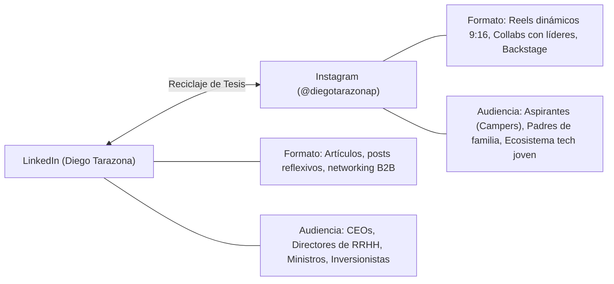

# 01: Estrategia y Rol del CEO en Instagram

## 1. El Propósito de Diego en Instagram
Instagram no es para Diego una red de entretenimiento superficial. Su perfil (`@diegotarazonap`) opera como una **plataforma de legitimidad ejecutiva, atracción de talento y liderazgo de opinión**:

1. **Humanizar la visión:** Mostrar la pasión, el esfuerzo real en las aulas y la cultura viva de Campuslands.
2. **Conectar con la juventud:** Hablarle directamente al joven de estrato 1, 2 y 3 en su propio canal de consumo diario.
3. **Validación ante aliados:** Demostrar a empresarios y figuras públicas que Campuslands no es una promesa vacía, sino un ecosistema con sedes activas, cientos de programadores formándose y empleo garantizado.

## 2. Complementariedad: LinkedIn vs. Instagram

## 3. Los 4 Pilares Invariables de Contenido
1. **Movilidad Social Real:** Demostrar con historias reales que el software y la IA cambian el destino socioeconómico de una familia en 13 meses.
2. **Metodología de Alto Rendimiento:** "Aprender haciendo", inmersión total (lunes a viernes) y cero teoría obsoleta.
3. **El Futuro de la IA y el Empleo:** Desmitificar que la IA destruye el trabajo y posicionar cómo aprovecharla para multiplicar productividad.
4. **Alianzas y Casos de Éxito:** Visitas de personalidades (Sergio Fajardo, embajadores, líderes de ACOPI) y testimonios de campers contratados por gigantes como Globant.

---
## 🔗 Conexiones del Segundo Cerebro
- **Proyecto:** [[projects/instagram-diego-tarazona|Proyecto Instagram Diego Tarazona]]
- **Persona:** [[people/diego-tarazona|Diego Tarazona]]
- **Entidad:** [[areas/campuslands|Campuslands]]
- **Sistema Editorial:** [[instagram/README|Sistema Editorial Instagram]]
- **MOC de Archivo y Análisis:** [[diego_instagram/README|MOC Instagram]]
