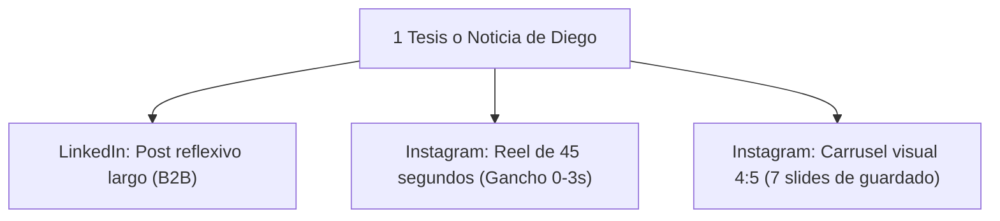

# 08: Matriz de Reciclaje Cruzado (LinkedIn <-> Instagram)

## La Regla de Oro: Crear una sola vez, distribuir en dos formatos

No tiene sentido duplicar el esfuerzo de redacción o pensar ideas desconectadas. Una sola tesis sólida de Diego alimenta ambos canales adaptando el código visual y el ritmo de cada plataforma:

---

## 1. De LinkedIn hacia Instagram (Down-Sizing / Dinamización)

| Elemento en LinkedIn | Cómo se transforma para Instagram |
| :--- | :--- |
| **La primera línea del post de LinkedIn** | Se convierte en el **Gancho verbal y visual de los primeros 3 segundos** del Reel. |
| **El cuerpo analítico con viñetas** | Se convierte en los **B-rolls y texto dinámico en pantalla** o en las **láminas 3, 4 y 5 de un carrusel**. |
| **La pregunta reflexiva final de LinkedIn** | Se transforma en un **Llamado a la acción con palabra clave**: *"Comenta la palabra X y te enviamos el enlace"*. |

---

## 2. De Instagram hacia LinkedIn (Up-Sizing / Profundización)

| Elemento en Instagram | Cómo se transforma para LinkedIn |
| :--- | :--- |
| **Un Reel espontáneo o detrás de cámaras en el campus** | Se redacta como un **caso de estudio ejecutivo**: *"Ayer mientras recorría las salas de cómputo en Bucaramanga, un camper me dijo algo que me dejó pensando sobre la educación tradicional..."* |
| **Una colaboración con una figura pública (ej. Sergio Fajardo)** | Se publica en LinkedIn destacando el **impacto de política pública, descentralización y empleo regional**. |
| **Preguntas recurrentes en comentarios de Instagram** | Se convierten en un **artículo de opinión semanal** en LinkedIn respondiendo a los mitos del mercado tech. |

---
## 🔗 Conexiones del Segundo Cerebro
- **Proyecto:** [[projects/instagram-diego-tarazona|Proyecto Instagram Diego Tarazona]]
- **Persona:** [[people/diego-tarazona|Diego Tarazona]]
- **Entidad:** [[areas/campuslands|Campuslands]]
- **Sistema Editorial:** [[instagram/README|Sistema Editorial Instagram]]
- **MOC de Archivo y Análisis:** [[diego_instagram/README|MOC Instagram]]
